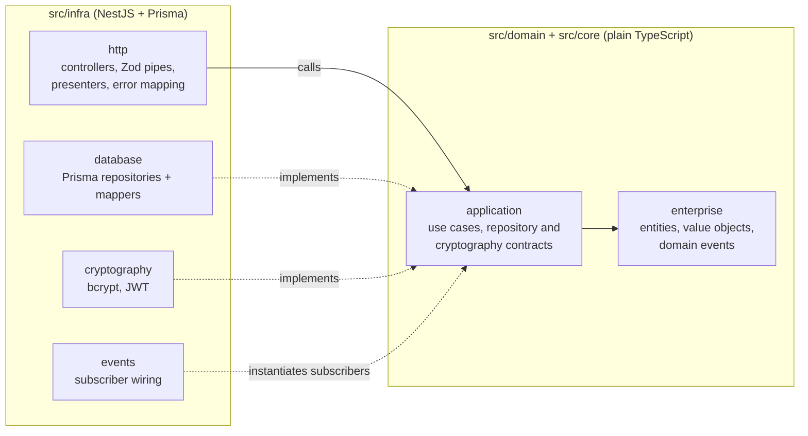

# Nest-Clean: Clean Forum API

A REST API for a Q&A forum (questions, answers, best answer, comments, notifications), built with **NestJS**, **Prisma** and **PostgreSQL**.

The business rules come from [ForumDDD](https://github.com/loboganng/ForumDDD), a domain-only project (entities, use cases, `Either`, domain events, repository interfaces, in-memory tests). This repository serves that domain over HTTP **without changing how the domain is written**: the domain layer has no NestJS, Prisma or HTTP imports, and an ESLint rule enforces this.


## Stack

| | |
|---|---|
| Language | TypeScript |
| Framework | NestJS 11 |
| Database | PostgreSQL 17 + Prisma 6 |
| Auth | JWT signed with an RS256 key pair (Passport), bcrypt password hashing |
| Validation | Zod (body, query and env) |
| Tests | Vitest (unit), Vitest + Supertest (e2e) |
| Infra | Docker, Docker Compose, GitHub Actions |

## Architecture

Dependencies point inwards. The domain does not know that NestJS, Prisma or HTTP exist.



```
src/
├── core/                 # Entity, AggregateRoot, Either, WatchedList, DomainEvents
├── domain/
│   ├── forum/
│   │   ├── enterprise/   # Question, Answer, comments, Slug, domain events
│   │   └── application/  # use cases + abstract repositories / cryptography
│   └── notification/     # Notification entity, use cases, event subscribers
└── infra/
    ├── auth/             # JWT strategy, global guard, @Public, @CurrentUser
    ├── cryptography/     # BcryptHasher, JwtEncrypter
    ├── database/prisma/  # PrismaService, repositories, mappers
    ├── events/           # registers the notification subscribers
    └── http/             # controllers, presenters, pipes, error mapping
```

### Design decisions

- **The domain has no NestJS dependency, not even `@Injectable()`.** Use cases are plain classes. `src/infra/http/use-cases.providers.ts` registers each one with a factory provider (`new CreateQuestionUseCase(questionsRepository)`). An ESLint `no-restricted-imports` rule fails the build if `src/core` or `src/domain` imports `@nestjs/*`, `@prisma/*` or the infra layer.
- **Repositories are abstract classes, not interfaces.** NestJS needs a runtime value as the injection token, and TypeScript interfaces disappear at compile time. An abstract class is still plain TypeScript, and `DatabaseModule` binds each one to its Prisma implementation.
- **Errors are values, not exceptions.** Every use case returns `Either<Error, Result>`. Controllers translate the left side into HTTP status codes in one place (`use-case-error-to-http.ts`): not found → 404, not allowed → 403, e-mail taken → 409, wrong credentials → 401.
- **Presenters decide the JSON.** Entities are never serialized directly, so the password hash or internal fields never leak.
- **Secure by default.** The JWT guard is global. Public routes (`/accounts`, `/sessions`) opt out with `@Public()`.
- **Domain events cross bounded contexts.** Creating an answer or choosing a best answer raises a domain event. The Prisma repository dispatches it after persisting, and the Notification context reacts. The Forum context does not know notifications exist.

## Endpoints

All routes except `POST /accounts` and `POST /sessions` require `Authorization: Bearer <token>`. Lists are paginated with `?page=` (20 items per page).

| Method | Route | Description |
|---|---|---|
| POST | `/accounts` | Create an account |
| POST | `/sessions` | Authenticate, returns `access_token` |
| POST | `/questions` | Create a question (slug generated from the title) |
| GET | `/questions` | Recent questions |
| GET | `/questions/:slug` | Question by slug |
| PUT | `/questions/:id` | Edit a question (author only) |
| DELETE | `/questions/:id` | Delete a question and its answers/comments (author only) |
| POST | `/questions/:questionId/answers` | Answer a question |
| GET | `/questions/:questionId/answers` | Answers of a question |
| PUT | `/answers/:id` | Edit an answer (author only) |
| DELETE | `/answers/:id` | Delete an answer (author only) |
| PATCH | `/answers/:answerId/choose-as-best` | Choose the best answer (question author only) |
| POST | `/questions/:questionId/comments` | Comment on a question |
| GET | `/questions/:questionId/comments` | Comments of a question |
| DELETE | `/questions/comments/:id` | Delete a question comment (author only) |
| POST | `/answers/:answerId/comments` | Comment on an answer |
| GET | `/answers/:answerId/comments` | Comments of an answer |
| DELETE | `/answers/comments/:id` | Delete an answer comment (author only) |
| GET | `/notifications` | Notifications of the logged-in user |
| PATCH | `/notifications/:notificationId/read` | Mark a notification as read (recipient only) |

`client.http` has ready-to-run requests for the VS Code REST Client extension.

## Tests

```bash
pnpm test       # unit tests: use cases against in-memory repositories
pnpm test:e2e   # e2e tests: real HTTP requests against PostgreSQL
```

- **Unit tests** come from ForumDDD and cover every use case and the core building blocks (`Either`, `WatchedList`, domain events).
- **E2E tests** boot the whole Nest app and call it with Supertest. Each test file runs in **its own PostgreSQL schema**, named with a random UUID. The schema is migrated before the file runs and dropped after it, so files never share data and can run in parallel (`test/setup-e2e.ts`). The e2e suite also checks the domain event flow: answering a question creates a notification for the question author.
- **CI** (GitHub Actions) runs lint, type-check, unit tests, e2e tests against a PostgreSQL service container, and the build on every push and pull request. The JWT key pair is generated for each run.

## Running locally

Requirements: Node 22, pnpm, Docker.

```bash
pnpm install
cp .env.example .env
```

Generate an RS256 key pair and put both keys, base64-encoded, in `.env`:

```bash
openssl genpkey -algorithm RSA -pkeyopt rsa_keygen_bits:2048 -out private_key.pem
openssl rsa -in private_key.pem -pubout -out public_key.pem
base64 -i private_key.pem | tr -d '\n'   # -> JWT_PRIVATE_KEY
base64 -i public_key.pem | tr -d '\n'    # -> JWT_PUBLIC_KEY
```

Start PostgreSQL (exposed on port 5434), apply the migrations and run the API on port 3333:

```bash
docker compose up -d
pnpm prisma migrate deploy
pnpm start:dev
```

To run the API in a container as well:

```bash
docker compose --profile app up -d --build
```

The image is a multi-stage build that keeps only production dependencies. It applies pending migrations on start.

## Changes to the ForumDDD domain

The goal was to serve the domain, not rewrite it. These are the only changes, each needed to run it against a real database:

- Repository interfaces became abstract classes (NestJS injection tokens, see above).
- `Student` gained `email` and `password`. Two use cases were added, `RegisterStudent` and `AuthenticateStudent`, behind `HashGenerator`, `HashComparer` and `Encrypter` contracts. They hold the account rules that used to live in the controllers.
- `FetchRecipientNotifications` was added, so the read-notification endpoint has a way to find notification ids.
- Bug fix: `ReadNotification` called `create` instead of `save`. This was invisible with the in-memory repository but fails on a real primary key.
- `DomainEvents` now catches errors thrown by async handlers, so a failing subscriber cannot crash the process with an unhandled rejection.
- Typos in class names were fixed (`CommentOnAnswernUseCase` → `CommentOnAnswerUseCase`).

## Known limitations

- **Attachments** are modeled in the domain and in the database, but there is no upload endpoint yet, so the API does not accept attachments.
- Two questions whose titles produce the same slug are rejected with `409 Conflict`. The domain has no rule for slug collisions, and inventing one was out of scope.
